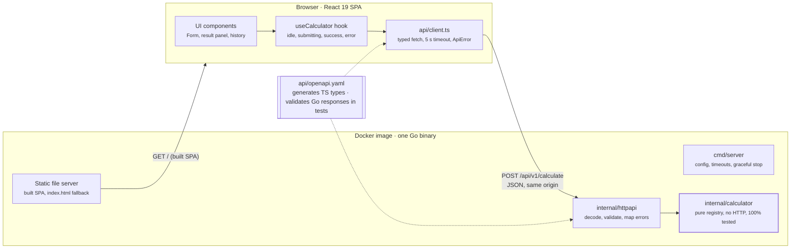

# Calculator — Technical Plan (TPD)

_As of 2026-11-10_

We will ship a stateless Go REST service and a React + TypeScript SPA, built from one OpenAPI contract and packaged as a single Docker image, in about 3.5 hours of work.

## Contents

1. [Scope and assumptions](#scope-and-assumptions)
2. [Architecture](#architecture)
3. [API contract](#api-contract)
4. [Backend design (Go)](#backend-design-go)
5. [Frontend design (React + TypeScript)](#frontend-design-react--typescript)
6. [Testing and coverage](#testing-and-coverage)
7. [Delivery: repo, Docker, CI, docs](#delivery-repo-docker-ci-docs)
8. [Execution plan](#execution-plan)
9. [Risks and open questions](#risks-and-open-questions)

## Scope and assumptions

We ship all four required operations plus the three optional ones, since each is a single pure function and adds little to the time. Correctness and clarity come before features.

**In scope**

- Operations: add, subtract, multiply, divide, power, sqrt, percent.
- Go REST service that validates input and returns JSON results and typed errors.
- React + TypeScript SPA with client-side validation, error display, and a layout that works at phone width (360 px and up).
- Unit tests and a coverage report for both layers.
- README, OpenAPI spec, PROMPTS.md, Dockerfile, CI.

**Out of scope**

- Expression parsing (for example `2 + 3 * 4`), memory keys, and persistence. Each request is one operation.
- Auth, rate limiting, and multi-tenant concerns. The service is stateless and has no user data.
- Arbitrary-precision arithmetic.

**Semantics we lock down up front**

| Topic | Decision | Why |
| --- | --- | --- |
| Number type | IEEE-754 float64 end to end | Matches JSON and JS `number`, so there are no conversion surprises. |
| Non-finite results | Rejected with `NON_FINITE_RESULT` (422) | JSON cannot encode NaN or Inf, and silent overflow is a bug. |
| Division by zero | `DIVISION_BY_ZERO` (422), including 0 / 0 | The PRD names it explicitly. |
| sqrt of a negative | `DOMAIN_ERROR` (422) | No complex numbers. |
| percent(a, b) | b% of a, which is a × b / 100 | The most common reading. Documented in the README and the UI label. |
| power(a, b) | `math.Pow`. Fractional power of a negative base gives `DOMAIN_ERROR` | `math.Pow` returns NaN in that case. |
| Float display | Server returns the raw float64. The UI formats to at most 12 significant digits | Keeps the API exact and the display readable, for example 0.1 + 0.2. |

## Architecture

In production, a single container serves both the SPA and the API from one origin, so no CORS is needed. In development, Vite on :5173 proxies `/api` to Go on :8080.



Requests flow from left to right. The calculator core is the only place math happens, and it never imports `net/http`.

## API contract

One generic `POST /api/v1/calculate` endpoint takes an operation name and an operand array. `api/openapi.yaml` (OpenAPI 3.1) is the source of truth, and both layers test against it.

We chose one endpoint over one per operation because adding an operation then means adding one registry entry, with no new route, handler, or client function. The cost is a slightly less RESTful URL, which is acceptable for an RPC-style calculator.

| Method | Path | Purpose | Success |
| --- | --- | --- | --- |
| POST | `/api/v1/calculate` | Run one operation | 200 `{ "operation", "operands", "result" }` |
| GET | `/api/v1/operations` | List operations with symbol, arity, and label. The UI builds its picker from this | 200 `{ "operations": [...] }` |
| GET | `/healthz` | Liveness for Docker and orchestrators | 200 `{ "status": "ok" }` |

Request and response:

```http
POST /api/v1/calculate
Content-Type: application/json

{ "operation": "divide", "operands": [10, 4] }
```

```json
200 OK
{ "operation": "divide", "operands": [10, 4], "result": 2.5 }

422 Unprocessable Entity
{ "error": { "code": "DIVISION_BY_ZERO", "message": "cannot divide by zero" } }
```

Error codes. The `code` field is stable and the UI keys off it; `message` is for humans.

| HTTP | code | When |
| --- | --- | --- |
| 400 | `INVALID_JSON` | Malformed body, unknown fields, body over 1 KB, or a trailing second JSON value |
| 400 | `UNSUPPORTED_OPERATION` | `operation` is not in the registry |
| 400 | `INVALID_OPERANDS` | Wrong count for the operation's arity, or a missing or non-numeric operand |
| 415 | `UNSUPPORTED_MEDIA_TYPE` | `Content-Type` is not `application/json` |
| 405 | `METHOD_NOT_ALLOWED` | Wrong verb. Returned by the Go 1.22+ router with an `Allow` header |
| 422 | `DIVISION_BY_ZERO` | Divisor is 0 |
| 422 | `DOMAIN_ERROR` | sqrt of a negative, or a negative base with a fractional exponent |
| 422 | `NON_FINITE_RESULT` | Result overflows to ±Inf or becomes NaN |
| 500 | `INTERNAL` | A recovered panic. No internals are leaked |

The split between 400 and 422 is deliberate: 400 means the request is malformed, and 422 means the request is well formed but mathematically undefined. The frontend can then show the first kind as a form-field error and the second as a result-area error.

## Backend design (Go)

The backend uses only the standard library: Go 1.22+ `net/http` method routing, `log/slog`, and `encoding/json`, with no web framework. The math lives in a pure package that knows nothing about HTTP, so it can be tested exhaustively with table tests.

| Package | Responsibility | Depends on |
| --- | --- | --- |
| `cmd/server` | Reads config from env (`PORT`, `STATIC_DIR`), wires dependencies, sets server timeouts, shuts down gracefully on SIGTERM | httpapi, calculator |
| `internal/calculator` | `Operation{Name, Symbol, Arity, Fn}` registry, pure functions, sentinel errors (`ErrDivisionByZero`, `ErrDomain`, `ErrNonFinite`) | stdlib `math` only |
| `internal/httpapi` | Router, handlers, request decoding and validation, mapping errors to HTTP status and code, middleware | calculator |
| `internal/httpapi/middleware` | Request ID, structured access log, panic recovery, CORS (dev only), body-size limit | stdlib |

Key decisions:

- **Registry pattern.** `calculator.Registry` is a `map[string]Operation` built once at startup. `Calculate(name, operands)` checks arity, calls `Fn`, then rejects NaN and ±Inf centrally, so no operation can return a non-finite value.
- **Errors as values.** Calculator functions return `(float64, error)` with sentinel errors. The HTTP layer maps them with `errors.Is` in one function (`toHTTPError`), so the status-code policy lives in one place.
- **Strict decoding.** `http.MaxBytesReader` (1 KB), `json.Decoder.DisallowUnknownFields()`, and a check that the body holds no second value. Operands decode into `[]*float64` so that a `null` operand can be told apart from 0.
- **Hardened server.** Set `ReadHeaderTimeout`, `ReadTimeout`, `WriteTimeout`, and `IdleTimeout`. Shut down gracefully with `signal.NotifyContext` and a 10 s drain.
- **Same-origin in production.** The Go binary serves the built SPA from `STATIC_DIR`, falling back to `index.html` for client routes. CORS is enabled only when `CORS_ORIGIN` is set for the Vite dev server.
- **Linting.** `golangci-lint` with `govet`, `staticcheck`, `errcheck`, `revive`, `gosec`, and `gofmt`.

We considered `chi` or `gin` and rejected them: since Go 1.22 the standard-library router supports methods and path patterns, and one fewer dependency is easier to review.

## Frontend design (React + TypeScript)

The UI is a form: operand A, an operation picker, and operand B, which is hidden for unary operations. We chose this over a keypad because it maps one-to-one onto the API, needs no expression parser, and is easier to validate and test. The stack is Vite, React 19, and TypeScript in `strict` mode, with no UI or state library.

| Module | Responsibility |
| --- | --- |
| `api/client.ts` | Typed `calculate()` and `listOperations()` built on `fetch`. Uses `AbortController` with a 5 s timeout and turns every failure into an `ApiError { code, message, status }` |
| `api/types.ts` | Types generated from `openapi.yaml` with `openapi-typescript`, so the contract cannot drift silently |
| `validation.ts` | Pure function that turns a raw input string into a number or a field error. Rejects empty input, `NaN`, `Infinity`, and over-long input. Pre-empts ÷ 0 and sqrt of a negative for instant feedback, though the server stays authoritative |
| `hooks/useCalculator.ts` | `useReducer` state machine with states `idle → submitting → success \| error`. Cancels the in-flight request on resubmit or unmount |
| `components/CalculatorForm.tsx` | Inputs, operation picker, submit. Hides operand B when the operation's arity is 1 |
| `components/ResultPanel.tsx` | Result, or error, in an `aria-live="polite"` region. Formats to at most 12 significant digits |
| `components/History.tsx` | Last 10 calculations, kept in memory only. Clicking one refills the form |

UX and accessibility:

- Each input has a `<label>`. Errors are linked with `aria-describedby` and `aria-invalid`. Enter submits, and the form works with the keyboard alone.
- Inputs use `inputMode="decimal"` so phones show a numeric keypad. The submit button is disabled while a request is in flight.
- The layout is CSS-only and mobile-first: a single column below 600 px and a centered card above it, with tap targets of at least 44 px. CSS custom properties allow light and dark themes via `prefers-color-scheme`.
- Errors split by type. 400 codes show as field errors. 422 codes show in the result panel, for example "Cannot divide by zero". Network errors and timeouts show a retry message.
- If `/api/v1/operations` fails, the picker falls back to a static list of the four required operations, so the core flow still works.

## Testing and coverage

Most testing effort goes into the pure layers (`calculator`, `validation.ts`), where tests are cheap and exhaustive. On top of that, a thin set of handler and component tests checks the wiring, and contract tests stop the two sides from drifting.

| Layer | Tool | What we assert | Coverage target |
| --- | --- | --- | --- |
| Go `calculator` | `go test`, table-driven | Every operation, including negatives, zero, very large and very small values, ÷ 0, sqrt(−1), Pow overflow to Inf, and NaN rejection | 100% |
| Go `httpapi` | `httptest` | Each status and code in the error table, bad JSON, unknown fields, oversized body, wrong Content-Type, 405, and panic recovery | ≥ 90% |
| Go `cmd/server` | `httptest` against the wired router | Health check, SPA fallback, static serving | Smoke only |
| Contract (Go) | `kin-openapi` validator | Each handler response validates against `openapi.yaml` | All endpoints |
| TS `validation`, `client` | Vitest, with MSW for HTTP | Parse edge cases. The client maps 400, 422, network errors, and timeouts to `ApiError` | ≥ 95% |
| TS `useCalculator` | Vitest `renderHook` | State transitions and abort on resubmit | ≥ 90% |
| Components | React Testing Library and `user-event` | Typing, submitting, seeing the result, errors announced, operand B hidden for sqrt, keyboard submit | ≥ 85% |

Coverage reporting:

- `make coverage` runs `go test -race -coverprofile=coverage.out ./...` and `vitest run --coverage` (v8), then writes HTML reports to `coverage/`.
- CI fails if Go total coverage falls below 85% or if the frontend falls below the thresholds in `vite.config.ts`.
- `docs/COVERAGE.md` records a snapshot of both summaries, which the PRD lists as a deliverable.

## Delivery: repo, Docker, CI, docs

The repo is a single monorepo, built as one image by a three-stage Dockerfile and checked by one CI workflow. `make` is the only entry point a reviewer needs.

```text
.
├── api/openapi.yaml          # contract, source of truth
├── backend/
│   ├── cmd/server/
│   └── internal/{calculator,httpapi}/
├── frontend/src/{api,components,hooks}/
├── docs/{TPD.md,COVERAGE.md}
├── Dockerfile  Makefile  README.md  PROMPTS.md
└── .github/workflows/ci.yml
```

- **Dockerfile.** Stage 1 runs `node:22-alpine` with `npm ci && npm run build`. Stage 2 runs `golang:1.2x-alpine` with `CGO_ENABLED=0 go build -trimpath -ldflags="-s -w"`. Stage 3 is `gcr.io/distroless/static:nonroot` holding the binary plus `/static`. It exposes 8080 and runs as non-root. The target image size is under 20 MB.
- **Makefile.** Targets are `dev` (Go on :8080 and Vite on :5173 with an `/api` proxy), `test`, `coverage`, `lint`, `gen` (regenerates TS types from the spec), `docker-build`, and `docker-run`.
- **CI** (GitHub Actions). Go and frontend jobs run in parallel: lint, typecheck, test with coverage gates, and an `openapi-typescript` diff check to catch stale generated types. A third job builds the Docker image and curls `/healthz`.
- **README.md** covers prerequisites, a quick start in one command (`docker run -p 8080:8080 ...`), local dev, `curl` examples for each operation and each error, the design decisions (a condensed version of this TPD), assumptions (the percent semantics and float64), and how to view coverage.
- **PROMPTS.md** lists the AI prompts used, as the PRD requires.
- **Git hygiene.** Small, conventional commits in the order of the execution plan, so the history reads as a story.

## Execution plan

The build takes six sequential steps and about 3.5 hours, ordered so that a working, tested vertical slice exists by step 4. If time runs short, we cut polish from step 5, never tests.

1. **Contract and scaffold (20 min).** Write `openapi.yaml`, `go mod init`, Vite scaffold, Makefile, lint configs. Done when: `make lint` and `make test` pass on empty projects.
2. **Calculator core (30 min).** Registry, seven operations, sentinel errors, and table tests. Done when: `internal/calculator` is at 100% coverage.
3. **HTTP layer (40 min).** Handlers, decoding, error mapping, middleware, `main.go` with graceful shutdown, `httptest` and contract tests. Done when: `curl` works for every row of the error table.
4. **Frontend data layer (40 min).** Generated types, `client.ts`, `validation.ts`, `useCalculator`, with MSW-backed tests. Done when: the hook tests pass against a mocked API.
5. **UI (40 min).** Form, result panel, history, responsive CSS, accessibility attributes, and RTL tests. Done when: the full flow works at 360 px and at desktop width, keyboard only.
6. **Ship (40 min).** Dockerfile, CI, README with curl examples, COVERAGE.md, PROMPTS.md, push. Done when: a fresh clone runs with `docker build && docker run` and CI is green.

If the budget tightens, we drop items in this order: History, then dark theme, then the `/operations` endpoint (replaced by a static list in the UI), then CI. The Dockerfile, README, and tests always stay.

## Implementation notes (deviations from this plan)

The build followed this plan. These details changed during implementation:

- **OpenAPI 3.0.3 instead of 3.1.** `kin-openapi` and `openapi-typescript` have the most reliable support for 3.0.
- **Toolchain.** Go 1.26, Node 24, React 19, Vite 8, and Vitest 5. TypeScript is pinned to 5.9 because typescript-eslint and openapi-typescript don't support TypeScript 7 yet.
- **Server errors appear in the result panel, not on fields.** `INVALID_OPERANDS` can't say which field was wrong, so every server error appears in the result panel with a title by category: "Invalid input" (400), "Can't calculate that" (422), "Connection problem" (network or timeout, with a retry button). Field-level errors come from client validation.
- **Fallback operation list.** The fallback contains all seven operations, not only the four required ones, so the UI looks the same whether or not `/api/v1/operations` loads.
- **Domain errors have specific messages** (for example, "cannot take the square root of a negative number"). `0 ^ negative` maps to `DIVISION_BY_ZERO`.
- **Client tests run in Node.** The client tests run in the Node environment against MSW, so the real `fetch` and `AbortController` are exercised. Hook and UI tests use an injected fake client.

## Risks and open questions

| Risk | Impact | Mitigation |
| --- | --- | --- |
| Float precision surprises (0.1 + 0.2) | Reviewer sees 0.30000000000000004 | UI formats to 12 significant digits. The README explains the float64 choice and says a decimal library is the upgrade path |
| Client and server validation drift | Inconsistent messages | Server is authoritative. Client checks only pre-empt the obvious cases, and the contract tests plus generated types guard the shape |
| Scope creep (keypad, expressions) | Blows the 4 h budget | Explicit non-goals and the cut order in the execution plan |
| Generic endpoint looks less RESTful | Reviewer pushback | Trade-off written up in the README, with per-operation routes noted as an easy alternative |

Open questions, with defaults we will use unless told otherwise:

- [ ] Is "b% of a" the intended percentage meaning? Default: yes, a × b / 100.
- [ ] Is a form-style UI acceptable, or is a classic keypad expected? Default: form.
- [ ] Target Go version? Default: the current stable release, with the minimum set in `go.mod`.
